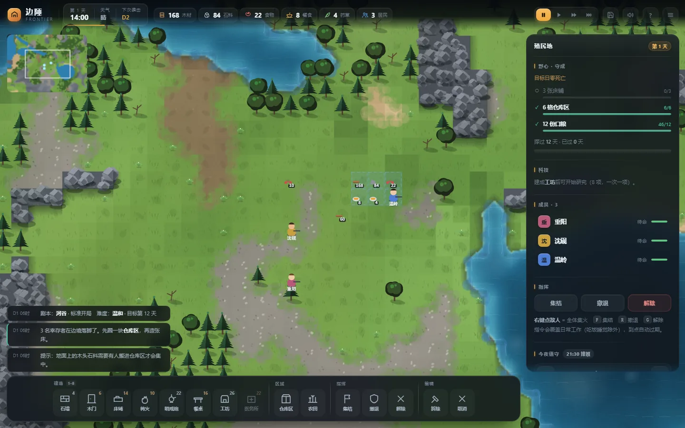
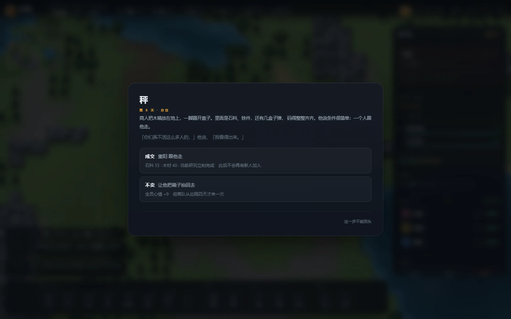
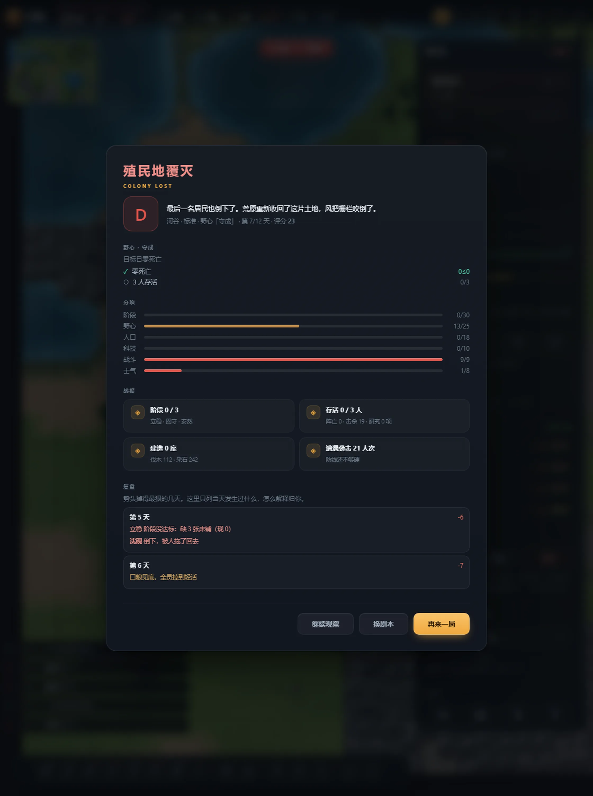
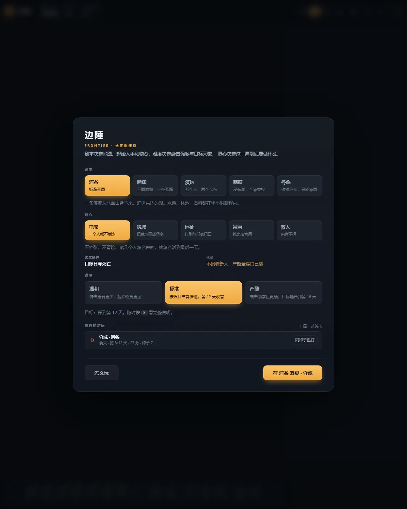

<div align="center">

# 边陲 · FRONTIER

**一款 12 天的边陲营地生存模拟。原生 JS + Canvas，零依赖，打开就能玩。**

[](#许可)
[](#技术说明)
[](https://github.com/cv-malin/frontier/releases)
[](https://cv-malin.github.io/frontier/)



</div>

---

你带着几个人在一片荒地上落地。十二天之后，要么这里成了一个据点，要么它变回荒地。

没有教程关，没有存档点。每天要做的只有一件事：**决定今天谁去干什么。**

## 下载与试玩

| | |
|---|---|
| **在线玩** | <https://cv-malin.github.io/frontier/> —— 打开就玩，手机也能开 |
| **发行包** | 在 [Releases](https://github.com/cv-malin/frontier/releases) 页下载 `frontier-v2.2.zip`，解压即玩 |
| **源码** | `git clone https://github.com/cv-malin/frontier.git`，然后双击 `index.html` |

三种方式都不需要 Node、不需要构建、不需要服务器。

## 怎么玩

一局十二天。白天干活，夜里睡觉，偶尔有人来抢东西。

**核心循环**：圈地 → 摆建筑 → 派人干活。每个人每天有 100 点**干劲**，重活（砍树、挖矿、砌墙、开荒）按游戏分钟扣，用完了就只能干轻活，或者去篝火边歇着。所以“今天谁能干什么”本身就成了稀缺资源。

**种田**是一条完整的链：

```
圈农田 → 开荒（46 分钟/格）→ 选种（麦/豆/根菜/药草）→ 等熟 → 抢收
```

地有**地力**。连作麦会把它耗瘦，豆能养回来，沙地底子本来就薄。熟了不赶紧收，会有偷粮贼来搬——他们不伤人，只搬粮，装够三袋就跑。

**每天还会有别的事找上来**：危机倒计时（河水上涨、寒潮、伤口化脓）、第二幕的二选一、以及那些撑过去了但留下旧伤的人。

<div align="center">

</div>

## 五张野心，五种打法

开一局先选**野心**。它不只是换计分板，而是换掉终点、连压力曲线一起换。

| 野心 | 目标 | 代价 |
|---|---|---|
| **守成** | 目标日零死亡 | 不招新人，产能全靠自己熬 |
| **筑城** | 10 段石墙 + 2 座哨戒炮 | 石料吃紧，没空种地 |
| **远征** | 平掉三个匪巢 | 人是在外面死的 |
| **富商** | 攒够一笔钱 | 得一直做买卖，风险自担 |
| **救人** | 把人带回来 | 人多嘴多，粮不够分 |

每张野心分三个阶段，各有截止日。阶段没达标不直接判负，但结算会扣分。

## 结算看得懂，重开有理由

打完一局不只给分数，还给**复盘**：系统会扫出这局里势头跌得最狠的三天，用当天真实发生过的事件原话解释发生了什么。

<div align="center">

</div>

> 第 5 天　−6
> 立稳 阶段没达标：缺 3 张床铺（现 0）
> 沈砚 倒下，被人拖了回去

每个人的**个人史**也留着：被谁打伤、什么时候落下旧伤、哪一天饿到发慌。阵亡的人有讣告和死因。

侧栏顶部有一行**今日瓶颈**，直接回答“为什么墙不涨”：人躺下了 / 没吃饱 / 工地没人 / 劲用完了 / 带伤 / 闲着。

<div align="center">

</div>

最近 20 局会存在本地，开场页列出战绩，每条可以**用同一个种子重打**。

## 目录结构

```
.
├── index.html            游戏本体（含全部样式）
├── js/
│   ├── 1-core.js         常量、地形生成、建筑/科技/野心/危机定义
│   ├── 2-render.js       Canvas 绘制
│   ├── 3-sim.js          模拟循环、工作分配、战斗、农业、危机
│   ├── 4-ui.js           侧栏、面板、弹窗、存档
│   └── 5-boot.js         启动、调试参数、断言
├── docs/
│   ├── prd/              各版本 PRD（含设计取舍与踩坑记录）
│   └── shots/            README 截图
└── _tools/               开发工具（回归、PRD 生成、打包）
```

## 开发

游戏没有构建步骤，改完 `js/*.js` 刷新浏览器即可。但改完**必须**跑回归——这套代码里随机数是全局的，一次多余的 `rnd()` 调用就会把整条世界线重排。

```bash
# 语法检查
for f in js/*.js; do node --check "$f"; done

# 单局：剧本 种子 难度 野心
python _tools/regress18.py one valley 7 calm fortify

# 全部十局
python _tools/regress18.py all
```

浏览器内断言用 URL 参数触发，结果写在 `<title>` 里，适合无头浏览器抓：

```
index.html?v22=1      # 运行档案与复盘（14 项）
index.html?v21=1      # 农业线（13 项）
index.html?v20=1      # 决策层（14 项）
```

其他调试参数：

| 参数 | 作用 |
|---|---|
| `?seed=N` | 固定随机种子 |
| `?scen=valley` | 选剧本 |
| `?amb=hold` | 选野心 |
| `?skipintro=1` | 跳过开场 |
| `?pm=1` | 直接打完一局看复盘 |
| `?archshot=6` | 快进六天看瓶颈与个人史 |
| `?help=1` | 打开帮助面板 |
| `?farmshot=1` | 农田演示场景 |

## 技术说明

- **零依赖**：没有框架、没有打包器、没有 `node_modules`。五个 `<script>` 标签按顺序加载，全部挂在全局。
- **纯 Canvas**：地图、人物、特效都是手绘，没有贴图资源，仓库里没有一张图会进游戏。
- **种子可复现**：全局 `rnd()` 由种子驱动，同一个种子 + 同一串输入 = 同一局。回归脚本靠这一点做自动化。
- **随机流纪律**：任何新增的、会消耗随机数的逻辑都会改变世界线。所以纯记录类功能（快照、个人史、偷粮贼）都走独立 PRNG 或完全不碰 `rnd`，`?v22=1` 里的 `snapNoRnd` 断言就是守这条线的。

设计演进和踩过的坑都写在 `docs/prd/` 里，最新一份是 [PRD v2.2](docs/prd/PRD-边陲-v2.2.html)。

## 发布

推送到 GitHub、打 tag、生成带 zip 的 Release、开 Pages，一条命令：

```bash
GITHUB_TOKEN=ghp_xxx ./_tools/publish.sh
```

它会依次做：建仓库（已存在则复用）→ 标准 `git push` 推 `main` → 打 tag → 建 Release → 上传 `dist/frontier-vX.Y.zip` → 开 Pages。

代码全程走 `git push`，**不做逐文件 API 写入**。API 只用在三件 git 协议本身做不到的事上：建仓库、建 Release、开 Pages。token 通过 `-c http.extraheader` 传给这次推送，**不落进 `.git/config`**。

可调参数：

| 变量 | 默认 | 说明 |
|---|---|---|
| `REPO_NAME` | `frontier` | 仓库名 |
| `VISIBILITY` | `public` | `public` / `private` |
| `PAGES` | `1` | 设 `0` 跳过开 Pages |
| `VERSION` | 读自 `_tools/pack.py` | 版本号 |

只打包、不发 GitHub：

```bash
python _tools/pack.py     # 生成 dist/frontier-vX.Y.zip，解压即玩
```

## 许可

MIT，见 [LICENSE](LICENSE)。
